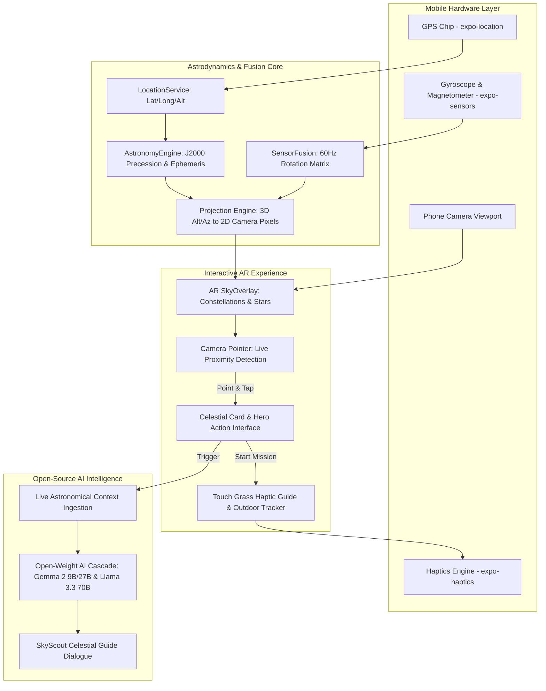

*This is a submission for the [Hacktoberfest Open-Source AI Challenge Week 1: Touch Grass](https://dev.to/challenges/hacktoberfest-week1-2026-10-05)*

I know many challenge submissions are built on laptops and web dashboards. But honestly—**if I want to go outside and touch grass, I'm taking my phone, not carrying a laptop outdoors.** 

I wanted to build an authentic, real-use-case mobile companion that actually forces you to step outside at night, look up from your screen, and explore the universe. SkyScout is a simple phone app where **you literally point your camera at any star in the night sky to lock onto it in real time and immediately ask Open-Source AI questions about it**—from ancient mythology and exact light-year distances to real-time astrometry and naked-eye spotting guides.

---

## What I Built

**SkyScout** is a real-time AR stargazing and celestial AI identification app for mobile that transforms ordinary outdoor night walks into an interactive, AI-guided universe exploration.

Instead of keeping your face glued to indoor screens or feeds, SkyScout turns your phone's camera and sensors into an intelligent astronomical viewfinder:
- **Point-and-Ask Real-Time Camera Lock**: Just point your phone camera toward any star, planet, or constellation in the sky. When the camera pointer aligns near a celestial body, it instantly triggers a glowing lock-on ring with an animated `👆 Tap to inspect` cue.
- **Instant AI Insights for Every Star**: Tapping any star opens an interactive card featuring a prominent **✨ Ask AI Astronomer** button right at the top. The open-source AI receives the star’s live telemetry—its current altitude above your horizon, compass heading, apparent magnitude, constellation, and distance—and gives you rich, conversational insights on the fly.
- **Live AR Celestial Projection**: Overlays astronomical coordinate lines, constellations, planets, and the Moon directly over your live camera feed in real time.
- **Hardware Sensor Fusion**: Reads device magnetometers, gyroscopes, and accelerometers at 60Hz to seamlessly align your phone's pitch, roll, and azimuth bearing with the cosmos above you.
- **"Touch Grass" Haptic Guided Missions**: Tactile challenges that guide you to find celestial bodies with your naked eyes using subtle vibration pulses, encouraging you to pocket your phone, let your eyes dark-adapt, and enjoy the real sky.

---

## Demo

- **Live Deployed App (Expo)**: [https://expo.dev/accounts/kartiik22/projects/sky/updates/19ba1ee0-e700-4b34-af2b-5e5a59b828dd](https://expo.dev/accounts/kartiik22/projects/sky/updates/19ba1ee0-e700-4b34-af2b-5e5a59b828dd)

> **📱 How to Run on Your Phone via Expo Go:**
> 1. Open the link above.
> 2. Click the **"Preview"** button at the top-right (with the QR icon) to open the QR code.
> 3. Scan the QR code using your phone's camera (iOS) or the Expo Go app (Android) to open the app directly *(make sure you have the free [Expo Go](https://expo.dev/go) app installed)*.
> 4. Allow camera, location, and motion permissions when prompted so the live AR star map can align with your sky.

---

## Code

Check out the full open-source repository on GitHub:



- **GitHub Repository**: [https://github.com/kartiik22/SkyScout](https://github.com/kartiik22/SkyScout)
- **Architecture**: React Native + Expo SDK 57 + TypeScript
- **Sensors & Projection**: `expo-camera`, `expo-sensors`, `expo-location`, `expo-haptics`
- **Astronomy Math**: `astronomy-engine` for dynamic ephemeris, coordinate transforms, and J2000 epoch precession.

---

## System Architecture

### Architectural Breakdown:
1. **Hardware & Sensor Fusion Layer**: Polls the device's 3-axis gyroscope, magnetometer, and accelerometer at 60Hz. It converts raw orientation angles into a continuous 3D rotation matrix (`M`), eliminating gimbal lock and jitter while pointing toward zenith.
2. **Astrodynamics Computation**: `AstronomyEngine` converts catalog Right Ascension & Declination coordinates $(\alpha, \delta)$ into the observer's local horizontal coordinates $(Alt, Az)$ in real time using the device's live GPS coordinates and local sidereal time.
3. **Viewport Projection**: Projects spherical coordinates onto the 2D plane of the phone screen using pinhole camera intrinsic optics, calculating field-of-view (FOV) clipping and constellation bounding vectors.
4. **Context-Aware Open AI Ingestion**: When the camera reticle locks onto a star, the app extracts the celestial object's real-time telemetry (exact altitude, azimuth, magnitude, constellation, and distance) and feeds it dynamically into open-weight models (`google/gemma-2-9b-it`, `meta-llama/llama-3.3-70b-instruct`) for instant, scientifically accurate celestial guidance.

---

## How I Built It

### 1. Dynamic GPS & Real-Time Ephemeris
The app does **not** hardcode celestial positions. Using `expo-location`, it queries live GPS coordinates (`latitude`, `longitude`, `altitude`) and feeds them into `astronomy-engine` alongside real-time UTC timestamps. 
Whether you're stargazing in Delhi, San Francisco, London, Tokyo, or Sydney, the app continuously computes the exact local Altitude (elevation above your horizon) and Azimuth (compass bearing) for every visible star, planet, and lunar phase.

### 2. Real-Time Camera Pointing & Target Lock
Using high-frequency 60Hz rotation matrices mapped from your phone's gyroscope and magnetometer, SkyScout projects 3D celestial coordinates $(Alt, Az)$ into 2D camera viewport pixels $[x, y]$. 
When your camera reticle sweeps close to a star, a proximity algorithm detects the target, pulses an animated target ring, and illuminates the star’s label with `👆 Tap to inspect`, letting the user know they can lock in and chat with the AI.

### 3. Real-Time AI Insights via Open-Source AI
SkyScout routes queries exclusively to open-weight models (`google/gemma-2-9b-it`, `meta-llama/llama-3.3-70b-instruct`, and `google/gemma-2-27b-it`):
- **Live Context Injection**: Every time a user opens the chat by pointing at a star, the system automatically injects that star’s real-time physical properties into the AI prompt:
  - Exact apparent visual magnitude (brightness)
  - Light-year distance from Earth
  - Current horizon altitude (e.g. $42^\circ$ above horizon) and compass heading ($185^\circ$ South)
  - Constellation name and mythological history
- **Interactive Stargazer Persona**: The AI acts as a passionate celestial guide, answering questions about cosmic scale, historical folklore, and practical naked-eye viewing tips while reminding users to actually look up into the sky.

---

## Why Does Open Innovation Matter?

Stargazing is humanity's oldest shared science—it belongs to everyone, not locked behind closed APIs or proprietary subscriptions. 

1. **Accessibility**: Open-weight models empower mobile developers to deliver deep scientific reasoning directly to users everywhere without expensive per-query paywalls or commercial lock-in.
2. **Transparent Cultural Heritage**: Astronomy blends rigorous physics with millennia of cultural lore and folklore across civilizations. Open-source AI ensures that knowledge remains community-driven, auditable, and freely accessible to everyone looking up at the night sky.
3. **Mobile-First Innovation**: Combining open-weight AI with on-device mobile hardware (cameras, magnetometers, GPS) demonstrates that AI isn't just for desktop chat windows—it can be an active sensor-driven companion that guides real-world physical exploration.

---

## Prize Categories

- **Primary Track**: *Touch Grass* (Real-world camera and sensor companion getting people off screens and outside into the night sky)
- **Open-Source AI Track**: *Best Real-World Open-Weight AI Application*

---

🌐 **Community Wisdom & Inspiration**:
- Special thanks to the dev.to open-source community exploring astronomy and mindful screen-time tools, including discussions like [sank8's terrace stargazing guide](https://dev.to/sank8/touch-grass-an-offline-terrace-stargazing-guide-on-open-weight-gemma-3i19) and [sweets' stargazing concepts](https://dev.to/sweets/i-built-a-cozy-stargazing-game-that-rewards-you-for-looking-up-o6m).
